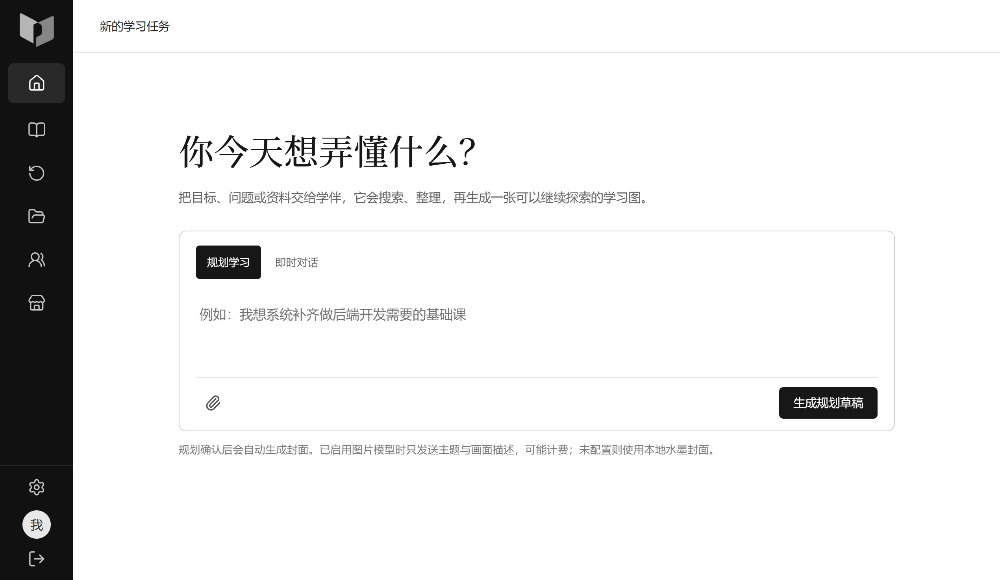
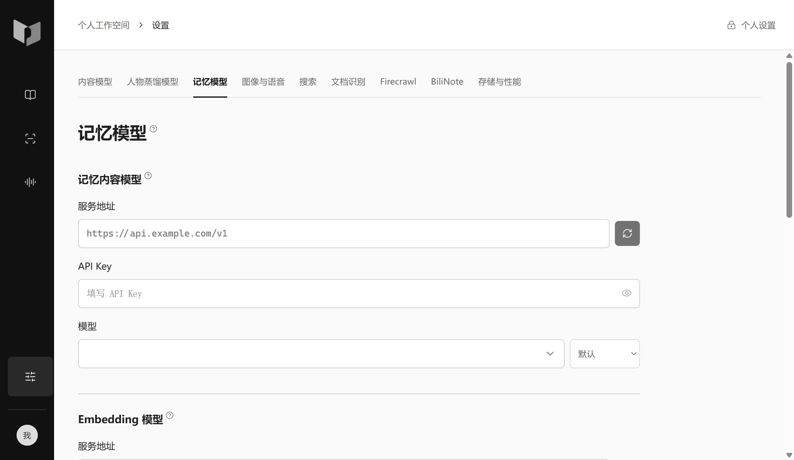

# 学习助手伙伴


把自己的资料变成学习路线、课堂讲解和练习反馈。

学习助手伙伴支持资料导入、对话式规划、板书讲解、课堂问答、单元测验、费曼练习、课程复习与个人记忆。模型服务由你选择，API Key 在应用设置中填写。

[下载安装包](https://github.com/tranhaianh20571-droid/computer-learning-assistant/releases) · [提交问题](https://github.com/tranhaianh20571-droid/computer-learning-assistant/issues)

## 桌面版

Windows x64 桌面预览版采用 Electron。安装时选择目录，首次启动自动准备应用自己的 Python、PostgreSQL、视频转写模型、个人记忆和课堂运行组件，无需手工配置开发环境。

1. 在 Releases 下载 `StudyCompanion-版本号-x64-Setup.exe`。
2. 安装后打开应用，等待组件下载、校验和初始化完成。首次准备需要联网，下载中断后可重试。
3. 在「设置」填写模型服务地址、API Key 和模型；记忆功能还需要兼容的 Embedding 与重排服务。

本地数据库和模型组件由应用管理，不使用电脑上已有的 Conda、Python 或业务数据库。视频默认使用 CPU 转写，不要求 CUDA。程序、运行组件和个人数据分开存放，卸载默认保留 `userdata`；再次安装到原目录可继续使用。

点击市集会弹出浏览器选择窗口，列出电脑上检测到的浏览器，也可以手动选择便携版浏览器程序，无需另外安装 Chrome。应用内部界面由 Electron 自带的浏览器引擎显示。

首次启动需要从 GitHub 下载约 1.9 GB 的运行组件，建议为安装目录预留至少 8 GB 空间；之后课程资料和数据库会继续占用空间。

这是首个桌面预览版本。独立新 Windows 虚拟机、不同显卡和全部真实模型供应商仍需分别验收；开发机上的隔离目录模拟不能覆盖这些差异。安装包尚未配置发布者代码签名。自动更新仅接收正式 Release，不自动切换到预览版本。

## 界面

以下为使用独立测试数据目录运行的实际桌面界面，不含个人课程或真实 API Key。





## 学习流程

| 环节 | 可以做什么 |
| --- | --- |
| 准备资料 | 导入文件、网页与视频，保留来源和原文定位 |
| 制定计划 | 通过对话明确目标、基础和学习范围，生成课程路线 |
| 上课与问答 | 板书、原文阅读、代码运行、语音与随堂追问 |
| 检验理解 | 单元测验、订正、费曼表达和课程复习 |
| 延续学习 | 保存课程进度、个人配置及按用户隔离的学习记忆 |

原始资料、改编内容和模型生成内容保持区分。使用外部模型、OCR、搜索或多模态服务时，相关能力和费用取决于你配置的供应商；本地安装环境不会赠送 API 额度，也不等于全部功能离线可用。

## 从源码开发

产品前端位于 `frontend/`，FastAPI 后端位于 `server/backend/app/`，Electron 工程位于 `desktop/`。开发环境与桌面安装包使用的受管数据库分开，启动开发环境前需准备本地 PostgreSQL、pgvector 和受忽略的 `server/.env`。

```powershell
# 前端
cd frontend
npm ci
npm run dev

# 另一个终端：后端
cd server/backend
uv sync --frozen
uv run uvicorn app.main:app --host 127.0.0.1 --port 8000
```

前端默认地址为 `http://127.0.0.1:5173`，后端入口为 `app.main:app`。

构建 Windows 桌面安装包需要 Node.js 24、uv、.NET 10 SDK 和联网环境：

```powershell
cd frontend
npm ci
npm run build
cd ../desktop
npm ci
npm run components
npm run dist
```

运行组件和安装包输出到受忽略的 `.backup/`，不提交到源码仓库。组件版本、大小和 SHA-256 位于 `desktop/manifests/runtime.json`，下载内容必须与安装包内的清单匹配。

## 验证与反馈

可执行测试统一放在 `tests/`。下载与校验检查：

```powershell
node --test tests/desktop_install_unit.mjs
```

数据库专项使用 `tests/run_native_regression.py` 创建并清理独立 schema，必须显式指定范围。桌面验证脚本分别检查空目录安装、进程环境、本地服务、真实窗口、课堂隔离和离线转写；合成数据与真实供应商结果分开记录。

反馈问题时请提供应用版本、Windows 版本、失败阶段及可复现步骤；不要上传 API Key、配置密文、数据库或个人学习资料。

## 仓库边界

`文档/`、本地环境、教材、数据库、模型文件、运行日志和私人实验材料不进入本次 GitHub 发布。展示截图位于 `assets/`，安装包和大型运行组件通过 Releases 分发。

第三方代码与运行组件保留各自的许可证。桌面运行边界见 [desktop/SECURITY.md](desktop/SECURITY.md)，源码工程说明见 [frontend/README.md](frontend/README.md) 和 [server/README.md](server/README.md)。
