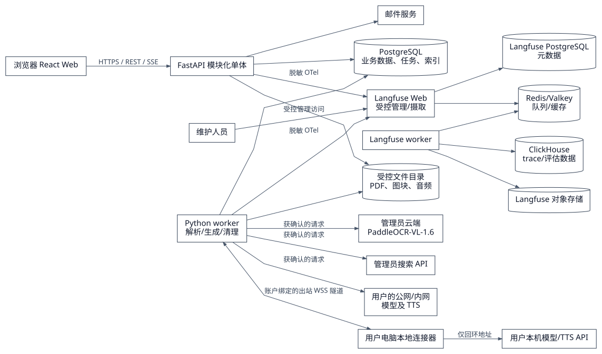

# 计算机领域辅助学习伙伴：首版架构设计与技术选型

> 版本：技术设计建议稿 v1.7｜2026-09-25  
> 需求基线：[PRD 草稿 v1.16](../../需求/prd-computer-learning-assistant.md)。该 PRD 仍为草稿；本文记录已确认的技术选型与实施建议；路线、课程大纲、学习总览和短段播放与 PRD v1.16 对齐，未实测项仍明确保留。v1.4 仅调整第 8 章的落地顺序组织方式（新增地基切片、外部契约 spike 前置、故障注入下沉至所属切片），未新增或改变任何技术决策与验收阈值。v1.5 将第 2 章与第 8 章对外部参考截图的引用改写为自述文字（原链接目标不在仓库内），已确认的信息结构、视觉基调与首版排除项均未改变。v1.6 新增一项已确认决策：工程模板只复用工程能力，前端界面与视觉组件自行实现。v1.7 将导图与课堂板书画布底座确定为 Excalidraw，并补充手绘线条、中文字体回退、场景转换和只读课堂画布边界（见第 2、5、7、8 章）。  
> GitHub 与供应商资料核对日期：2026-09-25。开源许可证结论针对所链仓库当前默认分支；实施时须锁定具体版本及依赖清单复核。

## 1. 结论与边界

**已确认（2026-09-25）**：首版采用 **React + TypeScript 前端、FastAPI（Python）模块化单体后端、PostgreSQL 数据库和独立 Python 后台 worker**。后端按功能划分模块，PDF 解析、内容生成和语音生成等耗时任务交给独立 worker 进程运行。以 `fastapi/full-stack-fastapi-template` 为工程起点，复用项目骨架；账户机制按本 PRD 改造，学习业务自行实现。**已确认（2026-09-25）**：模板只复用工程能力，不复用其前端界面与组件库；全部页面与视觉组件按第 2 章自行实现，详见第 7 章模板条目。内容生成与结构化 AI 输出采用 **PydanticAI**，提示词管理与 Agent 运维采用 **自托管 Langfuse**；任务编排、权限、幂等、业务版本和课程状态仍由本项目服务端负责。实施前锁定模板、PydanticAI 及 Langfuse 版本并复核依赖与许可证。

其余配套方案建议如下：采用桌面优先 Web 应用与受控文件存储，Web 前端与 API 同域部署；耗时的 PDF 逐页处理、搜索、生成和 TTS 均通过持久任务运行。任务调度可先用 PostgreSQL 行锁与租约实现，避免为少量获批用户维护额外消息中间件。用户电脑上的本机模型通过独立的本地连接器接入，服务端不把自己的 `localhost` 当成用户电脑。

这个方案按 PRD 的实际边界拆分：即时对话只产生文字消息；规划学习分多课程路线与单门课程，课程讲次才有教学步骤、板书、音频和恢复点。学习路线（可选）包含阶段与课程节点，课程大纲包含单元与讲次；独立课程无需路线。路线与课程大纲分别编辑确认，确认大纲后进入课程总览，用户选择讲次才启动教学。两条路径可复用资料检索、搜索与模型适配器，但不能共用“课程播放”状态机。首版不以向量检索、统一模型网关或大而全的教学平台为前置依赖，因为没有平台统一提供的嵌入模型，且用户自接模型能力各异。

### 1.1 关键设计原则

| 需求约束                       | 架构落实                                             |
| -------------------------- | ------------------------------------------------ |
| 邮箱验证、管理员审批后可用              | 服务端账户状态机与持久会话；停用、重置密码立即撤销会话。                     |
| 每人自接模型与可选 TTS；管理员统一 OCR、搜索 | 个人配置与管理员配置分库表和权限，密钥加密存储；三类模型协议分别适配。              |
| 外发前分别告知并确认                 | 生成“待外发清单”，确认记录绑定任务、接收服务、内容类别和范围；worker 出站前再核验。   |
| PDF 原图、结构图和部分可用            | 原 PDF 永久保留至用户删除；逐页/逐区域状态和原图坐标独立存储；关键结构图缺失不能标为完整。 |
| 搜索失败需用户明确选择                | 搜索结果含成功状态、时间和来源；失败转入等待用户重试/离线继续的状态，不伪造联网依据。      |
| 重试幂等、旧结果不可覆盖新会话            | 提交幂等键、任务 generation/revision、数据库唯一约束与写入时当前版本检查。  |
| 两级规划与思维导图                  | 路线版本与课程大纲版本分离；导图和总览读取同一结构化数据；草稿确认后才开放相应学习入口。     |
| 课程恢复与即时暂停                  | 播放控制在浏览器本地立即执行；持久化采用周期与事件双触发，显示最近成功保存状态。         |
| 5 GiB/人、扫描 PDF 最多 1000 页   | 上传入口和任务入口双重限额；逐页有界处理、临时文件清理与配额账本。                |
| 删除后在线 24 小时、备份 30 天        | 立即撤销访问，异步清理对象/索引/派生产物；备份轮换与恢复后墓碑重放。              |

### 1.2 实施冻结门槛

本文的技术方向可作为首版基线，但在以下门槛通过前不视为可直接开发冻结：任务租约围栏和调度隔离、模型能力探测与结构化输出降级、上下文预算、删除墓碑的独立持久化与恢复校验、OCR 坐标契约、领域模型图与正文一致性。其中任务租约围栏属于 §8 的切片 0 地基，OCR 坐标契约与模型能力探测属于 §8.0 的前置 spike，上下文预算与恢复校验分别归属切片 3 与切片 5；门槛的验收归属以 §8 切片表为准。供应商公开文档只能证明接口存在，不能替代本项目的样本、并发、故障注入和数据删除验收。

领域对象图的 PlantUML 源文件 `diagrams/learning-domain-model.puml` 与生成的 SVG 必须同步提交；课程、大纲版本、讲次内容版本、任务围栏和进度关系以该源文件及本正文的数据库设计为准，旧版“路线—学习节点”图不得继续作为实现依据。

## 2. 系统边界与部署

**已确认（2026-09-25）**：先在本机开发验证，正式试用时将共享服务部署到中国大陆区域的云服务器。本机开发环境不作为正式试用的长期服务端。首版部署基线为单台 Linux 云服务器、同区域备份和单机持久文件卷；具体云厂商、规格、域名及备份实现方式在正式试用前锁定，删除数据仍须在备份中 30 天内清理。

首版部署建议一台受控 Linux 主机或同一私网的少量容器：反向代理、静态前端、API、业务 worker、PostgreSQL 与持久文件卷；自托管 Langfuse 另含 Web、worker、ClickHouse、Redis/Valkey 和对象存储。Langfuse 管理面只允许维护人员访问，不与普通用户流量混用；其各组件使用独立凭据和最小权限。独立业务 worker 进程使 180 秒的单页 OCR、90 秒的生成调用不会占用 Web 请求。容器只挂载所需目录；业务文件卷和 Langfuse 对象存储不由反向代理直接公开。单机文件卷适合首版少量账户；增加多台应用节点时，将业务文件适配层切换为对象存储并验证删除时限，业务对象标识保持不变。

Web 接口采用 REST 写操作和 **SSE 单向任务事件流**：上传/解析/搜索/生成/TTS 的状态事件都带 `task_id`、`revision` 和事件序号；断线后可按序号补取，客户端也可通过 REST 查询最终状态。事件序号在单个任务内单调递增，服务端至少保留 7 天。客户端用 `Last-Event-ID` 请求同一任务的缺口事件，服务端先校验当前用户对任务的所有权，再按序回放；事件已过期或序号不连续时返回 `410 events_expired`，客户端必须改用 REST 全量状态查询并以当前 `revision` 重建界面。SSE 断线重连不能绕过任务鉴权，事件流不跨用户，也不接受客户端指定其他任务的游标。播放、暂停、静音、板书冻结不依赖 SSE 往返。首页四种入口由 `task_kind = plan | chat` 与 `scenario = self_study | school` 两个独立字段组合；规划任务另有 `planning_scope = auto | course | route`，默认 `auto`，实际生成前记录 `resolved_scope = course | route`。用户明确选择优先，歧义影响结果时进入等待澄清，不能默认所有规划都创建路线。切换入口或范围保留文字与附件选择，已有草稿保留并以新草稿承接范围变化。

页面职责：产品采用多个独立功能页面：课程规划、即时协助、路线总览、课程总览、讲次教学、资料和配置分别有清晰入口，可通过顶部模式切换或侧栏导航往返。课程规划页展示路线或课程大纲思维导图及节点详情；路线总览读取当前路线版本并展示阶段与课程；课程总览读取当前大纲版本并展示单元、讲次、准备状态及进度；教学工作区绑定某讲次会话。整体信息组织采用顶部模式切换加左侧栏导航的组合：顶部在课程规划与即时协助之间切换，左侧栏按资源类型分组列出路线、课程、资料与配置入口，主区域呈现当前所选对象。视觉以浅色和白色为主，使用黑色文字、深色导航和克制的强调色。导图与板书画布采用 Excalidraw（包名 `@excalidraw/excalidraw`）作为手绘风格画布底座，服务端结构化数据转换为受控的节点、文本、箭头、代码、公式、表格和原图元素；生成结果默认以只读课堂画布呈现，编辑模式另行开放。中文手写显示使用 Excalidraw 的 CJK 字体回退方案，并在实施时锁定字体文件及其许可证。层级列表、键盘编辑路径、业务排序和先修关系由本项目实现，不能把画布坐标当作业务顺序。窄屏保持所有节点可访问；具体版本在项目初始化时锁定。打开总览不自动发声，也不重复生成已有大纲。

前端验收边界按 PRD 固定：最新版及前一大版本 Chrome/Edge；桌面 ≥1024 px，窄屏 ≥360 px。窄屏课程在板书与对话区之间切换，保留输入和播放控制；即时会话只呈现文字。键盘可到达主要操作、控件有可读标签、正文可选择复制。课程总览、导图和教学工作区采用同一浅色视觉基线；具体间距和比例可在实现中微调，但不改变已确认的信息结构。

界面实现（**已确认（2026-09-25）**：前端界面自行实现，不沿用模板界面）：全部页面、视觉 token 与组件外观由本项目实现，含模板原有的登录、找回密码、重置密码和管理员用户页面，整个前端只保留一套组件体系，不与模板组件库并存。弹层、下拉、菜单、焦点陷阱与焦点返还、实时播报区域等无障碍交互原语不手写，采用成熟的无头（headless）组件库，外观由本项目样式覆盖；具体组件库与样式方案在模板落地时选定并锁定版本，选定前不视为已确认。Excalidraw 只复用画布、缩放、选择、箭头、自由绘制、撤销和场景序列化能力；节点详情、业务工具栏、生成状态、课程步骤和版本权限由本项目自行实现。手写效果包括手绘线条、点阵背景和中文手写字体，但正文、代码和公式必须保持可读并允许复制。任务状态、`partial` 部分可用、搜索失败待选择、草稿保存中 / 已保存 / 保存失败、`model_capability_unavailable`、上下文超预算、连接器离线与 `restore_locked` 等状态提示统一定义视觉规则，不由各页面各自设计。

## 3. 服务端模块与数据设计

### 3.1 模块职责

| 模块      | 主要职责及对外接口                                                                   |
| ------- | --------------------------------------------------------------------------- |
| 身份与管理   | 注册、邮箱验证、审批/拒绝/停用、登录、找回密码、会话撤销、审计。除注册/验证/登录/重置外，统一检查 `approved`。             |
| 能力配置    | 每人模型与 TTS、管理员 OCR 与搜索；配置测试只发非私人样例；维护文本/图像/TTS、工具调用、结构化输出、流式和取消能力状态。         |
| 资料      | 文件校验、配额、原件保存、逐页解析、图块裁切、区域可用性、章节与检索索引。                                       |
| 规划与路线   | 规划范围判断、信息缺口、搜索状态、路线草稿、阶段 / 课程节点及课程间先修 DAG、确认应用。                             |
| 课程大纲与总览 | 单元 / 讲次大纲、草稿编辑与 AI 候选、先修校验、版本确认、路线及课程总览、讲次完成与进度汇总。                          |
| 即时对话    | 纯文字消息、上下文和资料选择快照；新追问递增会话 revision，旧回答留历史但不能成为当前答案。                          |
| 课程教学    | 按讲次生成短步骤、板书与版本绑定音频，维护下一步预生成、追问与待续讲状态、恢复点。                                   |
| 任务编排    | 持久任务、幂等、租约、逐阶段结果、重试、超时和取消标记；并发限额。                                           |
| 外部适配    | OCR、搜索、三类内容模型、TTS、本地连接器；PydanticAI 负责内容模型调用、工具和结构化候选输出；统一错误类型、超时、响应大小和凭据脱敏。 |
| 清理与诊断   | 删除墓碑、在线/备份清理账本、阶段诊断、无正文事件指标。                                                |

建议数据主干：

| 领域      | 主要数据对象及职责                                                                                                                                                                         |
| ------- | --------------------------------------------------------------------------------------------------------------------------------------------------------------------------------- |
| 账户与外部能力 | `users`、`email_tokens`、`login_sessions`、`service_configs`、`connector_bindings`、`disclosure_grants`、`audit_logs`。                                                                  |
| 资料与任务   | `materials`、`material_pages`、`material_regions`、`figure_assets`、`text_chunks`；`learning_tasks`、`task_events`、`task_attempts`、`task_prompt_bindings`。                              |
| 学习路线    | `learning_routes` 保存当前路线版本；`route_versions`、`route_stages`、`route_course_nodes` 保存版本内阶段与课程安排，`route_prerequisite_edges` 保存课程间先修关系。                                                |
| 课程大纲    | `courses` 保存当前大纲版本；`outline_versions`、`course_units`、`lessons`、`lesson_content_versions` 和 `lesson_prerequisite_edges` 保存版本内单元、讲次、内容契约及讲次间依赖。                                     |
| 规划编辑    | `planning_drafts`、`planning_candidates` 保存草稿 revision、基线版本和 AI 候选；`planning_view_states` 单独保存画布位置、折叠和视角，不作为学习顺序来源。                                                                |
| 教学与进度   | `conversations`、`messages`、`teaching_steps`、`board_scenes`、`audio_assets`、`playback_checkpoints`；`lesson_progress` 保存讲次内容版本上的用户完成记录，`learning_navigation_states` 保存最近访问的课程、单元、讲次。 |
| 清理      | `deletion_tombstones`、`asset_usage_ledger`、`observability_deletion_refs` 覆盖路线 / 大纲草稿与版本、课程、教学产物和关联 Langfuse trace / 数据集副本。                                                        |

所有个人资源带 `owner_user_id`，子对象经父对象校验所有权。即时对话复用 `conversations/messages`；课程会话必须绑定 `course_id`、`outline_version_id`、`lesson_id`、`lesson_content_version_id`，教学步骤、板书和音频仅指向课程会话。文件下载使用短时受权响应。阶段归属与先修边、单元归属与先修边均分别存储，业务排序使用显式顺序字段。

路线与课程大纲是两个独立版本体系：`learning_routes.current_route_version_id` 指向当前路线，`courses.current_outline_version_id` 指向当前课程大纲。`route_course_nodes` 通过稳定课程标识关联课程实体，并保存该路线版本对课程的目标、范围与先修要求快照；课程可没有任何路线引用。由路线展开大纲时记录来源路线版本和课程节点、资料选择及生成依据。课程实体与路线编排不使用级联删除关系。

编辑已确认内容先建立草稿，不原地更新已确认版本。确认事务校验对象所有权、草稿 revision、字段、层级完整性和先修 DAG：路线至少一门课程；大纲至少一个非空单元，每讲只归属一个有效单元且先修引用属于允许范围。成功后创建不可变版本并更新当前指针。结构无效或存在并发冲突则整个确认不生效。首个课程壳可在草稿阶段创建，但 `current_outline_version_id` 为空时服务端禁止启动教学或 TTS。

确认接口使用“对象 + 草稿 revision + 幂等键”防重，草稿保存采用乐观锁；用户停止编辑 1 秒后触发自动保存，服务端成功响应后才更新已保存 revision，失败状态必须可见。AI 候选记录 `base_draft_revision` 与生成 revision；人工编辑后完成的旧候选可供查看，但不得替换新草稿，用户须重新生成或明确处理差异。导图与总览都由同一个已确认版本读取，不分别维护两套课程结构。

讲次稳定逻辑标识与内容版本分离。仅改显示标题、顺序或分组时可沿用 `lesson_content_version_id`；目标、范围或影响教学的先修约束变化时生成新内容版本，预览列出受影响讲次。确认新大纲不修改旧会话或恢复点，新内容版本不自动继承旧完成状态；若修改了教学文字，则音频与时标也须失效并重新绑定。删除新版讲次仅移除当前编排，旧版历史可回看。

课程进度按当前已确认大纲的讲次等权计算，匹配稳定讲次及内容版本上的完成记录。尚未确认大纲时显示准备状态；路线总览显示课程数量及各课程状态 / 进度，首版不计算路线整体百分比。准备状态（未生成 / 生成中 / 已就绪 / 失败）与学习状态（未开始 / 学习中 / 用户确认完成）分别存储。

路线调整顺序或分组不修改课程大纲；课程目标或范围快照发生变化时标记与现有大纲的差异，由用户决定生成调整候选或保留旧大纲。移出路线或删除路线均保留课程及其学习记录；删除课程则清理课程所属草稿、版本、讲次与教学产物，路线引用只保留不含课程正文的已删除提示。显式删除实体后的历史访问、在线 24 小时清理和备份 30 天轮换继续执行，历史版本不能绕过删除墓碑。

删除墓碑必须写入与业务备份分离、同等耐久的删除记录存储，并至少包含对象类型、对象 ID、所有者、删除时间、清理阶段和版本。备份恢复先进入 `restore_locked`，在开放任何用户访问前从独立删除记录源重放墓碑，重新检查对象、索引、派生产物、任务事件、观测引用和备份副本，校验完成后才解除锁定。RPO、RTO、备份加密、恢复演练频率和失败告警在正式部署前锁定。外部 OCR、搜索、模型和 TTS 服务的副本不受本系统墓碑直接控制，必须在外发确认页说明其保留周期和删除能力；本系统不能把供应商结果删除标记为已完成。

### 3.2 任务与一致性

任务表至少包含 `owner_user_id`、`kind`、`subject_id`、`stage`、`status`、`idempotency_key`、`generation`、`lease_owner`、`lease_token`、`lease_until`、`claimed_at`、`heartbeat_at`、`attempt`、`attempt_id`、`deadline_at`、`prompt_binding_id` 和 `model_config_version`。规划任务另记录 `resolved_scope`、目标对象、草稿基线和来源版本；任务种类区分 `route_generate`、`outline_generate`、`planning_revise`、`lesson_step_generate` 和 `tts`。API 在事务中创建任务与首个状态事件，故 UI 可在 1 秒内显示处理中；worker 用 `FOR UPDATE SKIP LOCKED` 领任务，每次领取生成新的 `attempt_id` 和不可复用的 `lease_token`，定期续租。续租、阶段完成、失败、取消和结果提交都必须匹配当前 `task_id + generation + attempt_id + lease_token`；租约失效的旧 worker 只能写入不影响业务状态的诊断记录，不能写入当前有效结果或创建后续任务。对 OCR 按“资料 ID + 页码 + 区域 + 解析版本”设唯一有效产物，对模型输出按“会话 ID + generation + 步骤号 + 内容版本”设唯一有效产物；重试只替换失败或过期尝试。

任务调度分为 `interactive`（即时对话、教学首段）、`teaching_prefetch`（下一教学段）、`ocr` 和 `maintenance` 四类。服务端为 `interactive` 保留最低并发容量，分别设置全局和单用户并发上限；维护任务不得占用保留容量，下一段预生成只能在当前教学段就绪后领取。队列等待时间计入任务总截止时间，重试次数、退避上限和超时按阶段记录；任何阶段达到总截止时间后进入可恢复失败，不得无限重试。

### 3.3 任务状态和提交规则

任务状态至少使用 `queued → leased → running → succeeded | failed | cancelled | expired`。`cancel_requested` 只是请求标记，不等同于已经取消；外部调用无法中断时，worker 返回后仍须执行租约围栏和业务版本检查。所有状态迁移、租约续期和结果提交使用数据库条件更新，提交失败只能生成诊断事件，不得把旧结果重新标成当前有效。

`task_prompt_bindings` 在任务创建时保存 `prompt_name`、来源（`langfuse` 或 `local_fallback`）、Langfuse 版本号（如有）、不含运行时用户数据的模板快照、模板 SHA-256、模型配置版本、结构化输出 Schema 版本、工具定义版本和 Agent 代码版本。任务只能引用该绑定；重试、继续课程和恢复不得重新解析 `production` 标签。模板快照和版本绑定写入同一事务，缺少绑定时不得发起模型调用。

模型或云服务完成后，worker **在提交事务时**再次检查账户/配置仍启用、用户确认仍覆盖当前发送范围、资源未删除、规划任务的草稿 / 来源版本或教学任务的会话 generation 仍为允许写入的版本。外部调用已经发出时不假装能够撤回，但结果不能越过该检查写成当前有效内容。`cancel_requested` 只停止下一阶段或尽力中断当前调用；用户发起不同的新问题使用新的幂等键，不能因重试保护而丢失。

搜索调用默认 20 秒、内容生成 90 秒、TTS 60 秒、云端 OCR **每页 180 秒**；在任务层设上限而不是让整份 PDF 共用一个超时。对同步 API 以请求超时计，对异步 OCR API 区分“单次 HTTP 请求超时”和“单页提交到结果就绪的 180 秒截止”；超过后标记该页失败并保存外部 job ID 供诊断，迟到结果不自动覆盖当前状态。服务失败仅重试相应阶段，成功的文字、图块、板书或音频保持可用。阶段超时、队列超时和供应商响应超时分别记录，不能用重试掩盖总截止时间。

## 4. 资料解析、检索与图像边界

1. **接收**：只允许 `.pdf/.md/.markdown/.txt`，单文件 ≤20 MiB、单次 ≤10 个，个人占用 ≤5 GiB。扩展名、MIME 与文件签名交叉检查；空文件、加密或损坏 PDF 明确报错。TXT/Markdown 严格按 UTF-8 或带 BOM 的 UTF-8 解码，拒绝其他编码。预留上传配额，完成/失败时按实际原件、图块及其他个人持久产物调整账本。
2. **逐页调度**：先从 PDF 页数检查扫描 PDF ≤1000 页，再每次只领取少量页面。约 200 DPI 临时渲染；限制单页像素、内存、CPU 时间与裁切尺寸，超大页按区域重渲染。可信文本层按有效字符、乱码率、阅读顺序和区域位置综合判断；可信区域直接提取，扫描/乱码/手写及结构失真的表格、公式进入云端解析。
3. **云端 OCR**：管理员配置 `PaddleOCR-VL-1.6` 文档解析 API。适配器必须核实实际为含 **PP-DocLayoutV3、区域裁剪、阅读顺序和 VL 识别的完整产线**，而非仅能调用 VL 子模型。每页和每个区域至少记录 `page_number`、`page_width`、`page_height`、`rotation`、`coordinate_system`、`region_bbox`、`reading_order`、所用模型、请求/完成时间、外部任务标识与错误。只发送用户已经确认的页或区域。
4. **原图保留**：供应商返回的图片/版面信息只作为候选。将其坐标按记录的页面尺寸和旋转信息映回原 PDF 页面，在受控渲染结果上重新裁出原图，记录 PDF 页码、坐标、图题及相邻文字；若供应商做过旋转、裁边或矫正，必须保存可复现的逆变换参数。定位失败时保留页码并支持按需重绘整页，不能把不可定位的 Markdown 图片链接当作原图依据。线路、电路、网络或神经网络结构图的原图是讲解依据，OCR 标签仅作检索线索；仅在视觉模型可用、用户确认图块外发且图像清晰时让模型分析连接关系，不把猜测当作精确网表/架构。
5. **可用状态**：每页、每个区域均有 `success/partial/failed` 与原因。关键结构图未进入素材时该范围最多 `partial`；扫描页 OCR 不可用时不能标为可用。只把成功区域和已裁出的图块纳入任务。资料删除后立即从新任务的检索范围移除。
6. **内置检索**：将章节标题、页码、文本段、图题与相邻文字建成本地倒排索引。应用层使用锁定版本的 jieba 词典处理中文词元，并把英文标识符、代码符号、版本号和页码作为独立词元写入 `tsvector`；PostgreSQL 不自动执行 jieba，分词结果必须由索引流水线明确写入。必要时以 `pg_trgm` 补充英文/代码的模糊召回，不能把向量模型作为隐式依赖。分词版本变化时重建索引并记录版本。查询条件先限定 `owner_user_id`、本任务选定的 material ID 集和可用区域，再排序取片段。图块结果携带原图资产 ID、图题、页码和关联文字。检索结果标记“资料内容”；网络搜索结果单独标记“外部补充”并记录获取时间。资料删除或区域失效时，同一事务写入索引删除账本。

这里的可行性闸口是 **云端供应商的结果契约**。官方 PaddleOCR API 文档列出 `PaddleOCR-VL-1.6` 文档解析及逐页结果；PaddleX 官方配置显示该产线使用 `PP-DocLayoutV3`。但采购/接入的具体托管接口仍需用真实样本核对：返回的版面区域坐标、坐标系、阅读顺序、图题关联、图像区域与逐页失败信息是否足以从原 PDF 稳定裁切。若只返回 Markdown 或无法定位的图片 URL，不能把这一供应商接口视为已满足 PRD，应切换到能暴露完整产线结构化结果的云端服务或接口版本。[官方 API CLI](https://github.com/PaddlePaddle/PaddleOCR/blob/main/docs/version3.x/inference_deployment/serving/paddleocr_official_api/cli.en.md)、[PaddleX 1.6 产线配置](https://github.com/PaddlePaddle/PaddleX/blob/release/3.7/paddlex/configs/pipelines/PaddleOCR-VL-1.6.yaml)、[百度云文档解析 API](https://ai.baidu.com/ai-doc/OCR/3mi73at9o)。

### 4.1 OCR 云接口调研（2026-09-25，验证顺序已确认）

用户已确认尚无现成 OCR 接口，并在调研后确定先验证 AI Studio 的 PaddleOCR 官方 API，百度智能云商业 API 作为备选。目前仅完成公开官方文档核查，未开通账户、购买服务或调用 OCR；下列候选均未通过本项目样本验收，正式采用仍以验证结果为依据。

| 候选接入路径                          | 官方文档已说明的能力                                                                                                                                    | 尚待验证                                                                 |
| ------------------------------- | --------------------------------------------------------------------------------------------------------------------------------------------- | -------------------------------------------------------------------- |
| AI Studio / PaddleOCR 官方 API    | 官方 Python SDK 可显式选择 `PaddleOCR-VL-1.6`，支持任务提交、状态查询与结果获取；服务说明列出 `useLayoutDetection`、逐页 `layoutParsingResults`、`prunedResult` 和 Markdown 图片结果。 | 实际账户的 1.6 端点、完整产线及结构化坐标字段；原图坐标映射、逐页失败与图题关联；实际配额、费用、服务保障和数据处理条款。      |
| 百度智能云“文档解析（PaddleOCR-VL）”商业 API | 当前文档标注 1.6；采用提交任务与轮询结果的异步接口，提供 Markdown/JSON 结果链接，并声明行级坐标能力。                                                                                  | 行级坐标不能单独证明结构图定位满足要求，仍须验证图片区域边界、页面尺寸与阅读顺序；模型版本锁定能力、逐页失败信息和完整产线配置也需核对。 |

**已确认（2026-09-25）**：开发阶段先验证 AI Studio 官方 API 的结构化结果与原图裁切，百度智能云商业 API 作为备选。坐标映射、逐页处理、费用、服务保障和数据处理条款仍按下述项目核对；两个接入路径的鉴权、结果封装和配额分别处理，不能假定接口通用。

费用与限制快照：百度智能云价格页列出个人实名认证测试额度 200 页，按量价格当前显示 0.05 元/页（1000 页约 50 元，未计试用与活动优惠），实际开通价格以控制台为准。AI Studio 配额页列出每用户每模型每日 20000 页；其服务参数页又存在默认只处理 PDF 前 100 页的说明，配额页则描述单文件超过 1000 页截断，两者不能作为具体端点处理上限的统一承诺。接入仍须按页或小批提交，检查请求与返回页数一致，1000 页总量由本系统调度。

数据条款：百度智能云文档说明结果链接有效期为 30 天，这不等于服务端数据在 30 天后彻底删除。本轮未确认两条路径对原文件、结果、日志的完整保留周期及训练使用约定，正式处理私人资料前仍须核对并告知。

样本验证至少覆盖扫描文字、手写、表格公式、线路图、神经网络图及旋转页面；检查能否按返回坐标从原 PDF 裁出完整结构图、正确关联页码与邻近文字，并验证单页 180 秒截止、失败页独立重试和迟到结果处理。若服务进行了旋转或扭曲矫正，还须验证坐标逆变换，不能仅按宽高比例映射。文档声明和通用模型评测均不替代这些验证。

核查来源：[PaddleOCR 官方 Python SDK](https://www.paddleocr.ai/main/version3.x/inference_deployment/serving/paddleocr_official_api/python.html)、[AI Studio 1.6 服务参数与结果](https://ai.baidu.com/ai-doc/AISTUDIO/Cmkz2m0ma)、[AI Studio 配额规则](https://ai.baidu.com/ai-doc/AISTUDIO/Xmjclapam)、[百度智能云接口](https://ai.baidu.com/ai-doc/OCR/3mi73at9o)、[百度智能云价格](https://ai.baidu.com/ai-doc/OCR/Imtti0n62)。

### 4.2 联网搜索接入（2026-09-25，复用方案已确认）

**已确认（2026-09-25）**：将 Tavily Hikari 作为独立服务复用，由管理员统一配置，学习助手通过搜索适配器调用其 HTTP 搜索接口；首版不自建 Tavily 聚合和密钥池管理功能。此决定确定复用方案，不代表现有实例已完成接入验证或可直接用于云端正式试用；上游账号条款、日志处理与以下适配检查仍须完成。

**许可证核查（2026-09-25）**：本机 Compose 配置的镜像为 `ghcr.io/ivanli-cn/tavily-hikari:v0.78.0`，对应仓库为 [IvanLi-CN/tavily-hikari](https://github.com/IvanLi-CN/tavily-hikari)。已读取 [v0.78.0 的 LICENSE](https://github.com/IvanLi-CN/tavily-hikari/blob/v0.78.0/LICENSE) 与 [当前 main 的 LICENSE](https://github.com/IvanLi-CN/tavily-hikari/blob/main/LICENSE)，两者均为 MIT，版权声明为 Copyright (c) 2025 Ivan Li。项目自身许可证允许商业使用、修改、分发及销售，未要求公开本项目源码；复制或分发软件及其实质部分时须保留版权和许可声明。此结论未覆盖全部第三方依赖，实际交付版本仍须保存许可证并复核依赖清单。

上游服务另行约束：[Tavily 平台服务条款](https://www.tavily.com/terms)（页面标注 2026-05-04 更新）允许按协议集成到客户应用，同时约束 API/账户共享、服务转售、调用额度，以及隐藏客户或应用身份。Hikari 的 MIT 许可不授予这些上游权限；部署前须核对所用账户与套餐、密钥池来源及转发配置，不能把多 Key 轮换理解为可绕过额度或账户限制。当前结论为“Hikari 项目代码允许商用，上游服务的具体使用方式仍待核对”。

用户补充的使用意图：已有多个 Tavily 账号，各账号额度较少，希望通过统一入口调度使用。已确认的接入关系为“学习助手 → 搜索适配器 → Hikari → 可用的 Tavily Key”。学习助手保存 Hikari 服务地址及访问凭据，多个 Tavily Key 由 Hikari 管理；适配器负责统一结果、总超时和失败状态，未来可替换为官方直连或其他实现。多个账号的额度仍分别结算，聚合仅调度请求，不使额度在上游合并；多个账号的使用授权须按实际套餐核对，不能推定多个免费账号叠加已获允许。[Tavily 官方说明](https://community.tavily.com/t/support-for-multiple-api-keys/28)也明确同一账号内多个 Key 共享套餐总额度。

复用适配检查：[v0.78.0 README](https://github.com/IvanLi-CN/tavily-hikari/blob/v0.78.0/README.md)描述了密钥池、额度耗尽后的调度和管理界面，也说明审计日志保存请求查询与上游内容。因此须核对日志配置或进行必要改造，以满足本项目不默认记录私人正文的要求；还须实测禁用密钥不会被重新调用、额度耗尽时有限失败、Hikari 与应用重试共用 20 秒总截止，避免重复重试延长等待。以上为复用条件，未对现有实例作改动或认定已通过。

实施前核对实际接口与鉴权、搜索结果的来源 URL 和获取时间、错误与配额信息、20 秒超时及取消后的结果处理，并核对费用和上游数据处理条款。正式试用时的 Hikari 部署位置及云服务器访问路径另行确定，不能将开发电脑的 `localhost` 配置直接用于云端。接入后仍执行管理员凭据隔离、用户外发确认和搜索失败时等待用户重试或明确离线继续的既定规则。

## 5. 规划、问答、课程与板书

### 5.1 共用的生成前处理

每次任务固定 `scenario`、规划任务的 `resolved_scope`、所选资料 ID 及其可用内容快照、模型配置版本和外发授权。任务还必须固定上下文预算：`max_input_tokens`、`max_retrieval_chars`、`max_retrieval_chunks`、`max_images` 和 `max_history_messages`。服务端保存不含正文的 `context_manifest`，至少记录资料片段 ID、图块 ID、历史消息范围、截断原因、摘要版本和清单哈希；摘要或截断不能扩大资料选择或外发授权。超出预算时进入可见的范围缩小/补充资料状态，不能静默丢弃当前讲次目标或关键图块。学校课程无附件时，用表单/追问补齐课程或主题、学习范围、当前进度；自学收集目标、基础和可用时间。路线与课程大纲生成均必须真实尝试搜索；软件版本/更新类即时问题按需搜索。搜索失败时任务进入 `awaiting_search_decision`，只有用户选择重试或明确离线继续后才进入生成。资料不足、搜索失败、模型纯文字/不识图等限制进入生成上下文及可见答复，不能在呈现层偷偷抹去。

生成模型的返回按路径分别使用 PydanticAI 的 Pydantic 输出模型做结构化校验：路线候选（阶段与课程）、课程大纲候选（单元与讲次）、课程步骤、板书声明、即时文字。能力配置必须先记录文本、图像、工具调用、JSON Schema、流式和取消能力；根据探测结果选择 `native`、`tool` 或 `prompted` 输出模式。连接测试成功不等于结构化输出成功；不支持所需能力时进入明确的 `model_capability_unavailable`，不能无限重试。模型输出只是候选数据；服务端继续验证最大长度、课程间及讲次间先修 DAG、业务排序满足先修、板书元素白名单、图块 ID 所有权及版本，校验失败只重试生成/转换环节。上传文档和网页内容作为引用数据隔离，不能提供新系统指令、权限或代码执行能力；本产品不执行用户资料中的代码示例。

规划范围在入口统一解析。用户指定 `course` 或 `route` 时优先遵从；`auto` 依据目标、基础和边界形成建议，明确课程 / 教材 / 章节通常指向单课，跨领域或职业目标通常指向路线。不得依附件数量、场景或主题关键词硬性决定；存在会改变结果的歧义时进入 `awaiting_scope_clarification`。生成前可见范围及切换入口；切换保留输入并建立新草稿，不原地转换旧草稿。

多课程规划先生成路线导图，用户确认后进入路线总览。选择尚无大纲的课程时，按来源路线版本的目标与先修要求创建大纲生成任务；已有草稿恢复编辑，已有确认大纲进入课程总览，失败任务提供重试。路线中安排过的先修课不等于已掌握，要结合已知基础及真实学习记录给出提示。

单门课程直接生成课程大纲导图。路线导图展示到课程，课程导图展示到讲次，知识点在讲次详情中呈现。导图使用 Excalidraw 的节点、文本和箭头元素，并配确定性层级布局；树形归属与先修边分开表达，提供层级列表和明确的业务排序操作。白板采用点阵背景、手绘线条和中文手写字体，代码、公式、表格和原图使用可复制、可读的专用元素。业务顺序、层级归属、画布位置和折叠状态分别保存，不依赖模型直接输出可执行图形代码。

路线材料仅作为课程任务的待选候选，不自动扩大选定资料或授权范围。确认大纲后进入课程总览；首段教学生成只由用户选择讲次触发。草稿生成、修改、保存、确认与总览查询为独立操作，重开页面不会重发生成。规划草稿状态见 PRD 图 9，搜索失败与范围澄清为明确等待状态。

### 5.2 即时对话

`chat` 会话只有文字消息和生成状态。提问可带选定资料和必要的外部搜索；视觉分析获准时模型可看原图，但对用户的结果仍是文字。新追问到来使 `conversation.generation` 加一；之前正在生成的答案可存为历史完成/中断状态，不能回填当前消息位置。刷新后只恢复已保存消息和上下文，不自动重发原问题。即时路径的服务端路由不调用板书、TTS 或播放 API。

### 5.3 课程步骤与播放

课程会话先固定已确认大纲与讲次内容版本，独立课程使用同样的教学路径。一个教学步骤存 `text_version`、不可变的 `board_scene_version`、可选的 `audio_version`。板书声明是受限 JSON：标题、要点、代码、公式、表格、节点、连线、高亮、原图引用以及展示顺序/时标。课程讲解和课程追问每段有完整文字和至少一个有助理解的板书元素；结构图被讲解时必须挂原图资产。前端用 Excalidraw 场景元素承载文字、代码、公式、表格与图像，另写确定性的步骤播放控制器，按版本与时标显示元素。手写线条和中文手写字体只影响呈现层，不改变节点 ID、业务顺序或版本数据。用户拖动、缩放或回看后保持其视角，只有主动“回到当前讲解”才重定位。板书模型输出不能直接注入任意 HTML、脚本或外部图片 URL。

播放控制器维护单一 `HTMLAudioElement`；切换步骤或追问先暂停现有音频，随后换源。点击暂停时先在本地停止音频并冻结板书时钟，随后异步持久化，满足 200 ms 响应的技术路径。音频未缓冲或未配置时不推进后续板书；TTS 缺失/失败，或字幕时标缺失、无法可靠对齐板书时，均由用户选择无音频手动推进，页面明确显示无音频模式。文字更改后旧音频标记失效，TTS 仅用同一 `text_version` 生成；**已确认（2026-09-25）**：采用短段准备好再播放，单段目标时长 30–60 秒，120 秒为硬上限，超过上限必须拆分为多个步骤。文字校验成功后即可阅读，当前短段的板书和完整同版本音频准备好后可由用户播放；无音频手动模式须有可用文字与板书。原课程播放时准备下一段，首版预生成窗口为一段，不等待整讲或整课生成，不因确认大纲批量调用 TTS。下一段未就绪时保持等待，不启动其板书时钟。首段文字与音频指标从课程总览点击某讲“开始学习”计时，路线 / 大纲生成耗时单独记录。

发送课程追问时暂停当前音频和板书，并创建**一次性的原课程恢复点**，保存步骤、音频毫秒位置、板书已呈现元素/时标和视角；首步未开始单独记 `not_started`。连续追问沿用最初恢复点，追问的板书与原课分开存。原课程和追问使用独立生成作用域，发送追问后关闭原课程预生成调度，给在途请求标记尽力取消。提交时核验作用域与内容版本，迟到结果不抢占当前追问，不继续提交下一段任务；旧生成代次的结果只能作为历史或暂存产物，不能直接发布。继续课程时先核验已就绪原课步骤的版本，再供恢复复用，用户点击播放后重开下一段调度。回答后状态为 `awaiting_resume`，只有用户点击继续课程并再点击播放才恢复声音。若浏览器无法精确 seek，提示从该步骤开头重播，使用相同板书 scene 版本复位显示，不能重复追加元素。

课程切步骤、暂停、发追问及回答完成时保存位置，播放期间每 5 秒发起保存一次。`playback_checkpoints` 采用单调 `client_seq` 和乐观版本检查，旧请求不能覆盖新位置；UI 只把服务器确认的 checkpoint 显示为“已保存”。重开课程按最后成功保存点恢复且保持暂停。正常网络下最长回退 ≤10 秒，断网/保存失败明确提示。断网时已加载文字与板书可读，重连后不自动发声。

### 5.4 TTS 接入（2026-09-25，首个服务已确认）

**已确认（2026-09-25）**：首版优先适配 MiniMax 语音合成，作为首个 TTS 服务；默认使用 `speech-2.8-hd`。课程配置提供多个可选内置音色，用户可按账户实际可用列表试听并选择，不把单一音色写死为产品常量。未配置或失败时，课程可由用户选择无音频手动推进。具体音色 ID、默认音色和账户对应的服务区域仍需在实际账户中核对。

官方文档核查：MiniMax 同步 HTTP 接口为 `POST /v1/t2a_v2`，支持流式与非流式输出、MP3 音频及字幕时间戳；当前文档列出句级、词级及流式词级字幕选项。模型列表包含 `speech-2.8-hd`、`speech-2.8-turbo` 等，本项目首版选用 `speech-2.8-hd`，不接入异步长文本接口。国内文档当前示例地址为 `https://api.minimax.cn/v1/t2a_v2`，国际文档示例为 `https://api.minimax.io/v1/t2a_v2`；实际地址、凭据、音色列表与能力须按用户账户核对。来源：[国内官方接口文档](https://platform.minimax.cn/docs/api-reference/speech-t2a-http)、[国际官方接口文档](https://platform.minimax.io/docs/api-reference/speech-t2a-http)。

TTS 适配器固定保存 `model`、`voice_id`、服务区域/端点、`subtitle_enable=true`、`subtitle_type`、音频格式、请求文本哈希和供应商 `trace_id`。首版短段使用非流式 `hex` 音频结果，由 worker 解码后持久化；不依赖供应商 24 小时临时 URL。单段目标时长为 30–60 秒，仍须校验供应商文本长度限制；超过适配器上限时在生成前拆段，不等调用失败后再截断。

**已确认（2026-09-25）**：按教学短步骤准备完整音频后播放，播放期间准备下一段。首版适配建议使用 MiniMax 非流式 HTTP 合成短段并获取时间戳，由后台 worker 持久化音频后提供受权播放；选择 URL 输出时在供应商链接到期前保存，不依赖外部临时 URL 恢复课程。

时间戳与板书绑定采用供应商返回的字幕时标；音频和时间戳绑定同一文字版本，不能由生成模型猜测时间。代码和公式口语化的朗读文本应保存与显示文字的对应关系及内容版本。字幕时标缺失或无法可靠对齐时，该段音频不得发布为可播放内容，课程进入无音频手动模式并提供重新生成入口；不强行推进时序板书。术语发音、延迟和断点恢复仍需样本验证；费用与数据处理条款亦待核对。本轮未调用服务或验证性能。音色选择只影响音频配置和后续音频版本，不改变讲解文字、板书或课程进度。

## 6. 身份、隐私、网络与本地连接器

账户状态至少 `pending_email → pending_approval → approved`，另有 `rejected/disabled`；首个管理员通过一次性部署命令生成，不经普通注册。密码用 Argon2id 哈希；至少 15 字符，接纳至少 64 字符，屏蔽常见/已泄露密码。登录失败按 PRD 的“同一账户 15 分钟 5 次后暂停 15 分钟”执行，用户存在与否给一致反馈。登录采用服务端随机会话 ID 的 HttpOnly、Secure、SameSite Cookie，数据库记录可立即撤销；写请求做 CSRF 防护。重置令牌只存哈希、30 分钟一次性，成功后撤销旧会话。

个人模型/TTS 凭据和管理员 OCR/搜索凭据分开保存，以服务端主密钥加密；浏览器只收到掩码、协议、模型名及能力状态。主密钥放部署密钥管理/受限环境，不写仓库或日志。每次外发前展示接收服务、用途、拟发送的内容类别与范围：云 OCR、搜索、个人模型及 TTS 分别记录确认；授权记录含用户、任务/资料、目标配置版本、类别、确认时间。更换服务地址、扩大内容范围、删除配置或撤销同意后须重新确认。服务器端权限校验覆盖文件和图块下载、检索、消息、音频与任务事件，不能仅凭“不可猜测 ID”保护资源。

公网模型地址要求 HTTPS，并限制跳转、DNS 重绑定和云元数据地址；每次解析和重定向后重新检查 IP，拒绝回环、链路本地、私网和云元数据地址，限制允许端口、响应大小和跳转次数。用户填写的内网地址只在管理员允许的网络边界内由服务端访问。本机连接器通过用户登录后的一次性短时配对码绑定账户与设备，主动建立出站 TLS/WSS 通道；每个请求带账户、设备、任务、过期时间和 nonce，服务端拒绝过期或重复 nonce，连接器只接受绑定账户的任务并限制请求大小与调用类型。连接器只允许本机回环目标，并在本机完成模型/TTS 调用，不监听公网端口。连接器凭证可撤销，撤销后拒绝新请求并使在途请求失效，断开时标记该路径离线。以上是建议的传输方案，实施前要以目标部署网络完成握手、重连、禁用、重放防护及跨用户隔离验证。

服务端把资料/网页视为不可信数据；Markdown、代码、公式与板书元素统一走安全渲染，链接默认不自动请求，图片只来自经过鉴权的原图资产。日志记录 `trace_id/user_id/task_id/stage/error_code/duration`，默认不记正文、提示词全文或 API 密钥。上线前逐个核对供应商数据处理、保留条款及是否支持所需模型和接口，并在界面展示服务信息。

## 7. 开源项目推荐与许可证核对

下表列出已选定的工程模板及 **可用于商业项目的候选组件**，各项选用状态见适配工作/限制栏。许可证判断以各项目仓库链接为依据；第三方依赖、模型权重、服务 API 和资源文件可能另有条款，锁定版本后生成 SBOM 并保存许可证文本。开源代码可商用不等于云服务调用免费。

| 优先级 | 项目与许可证依据                                                                                                                                                      | 可复用部分                                                     | 适配工作/限制                                                                                  |
| --- | ------------------------------------------------------------------------------------------------------------------------------------------------------------- | --------------------------------------------------------- | ---------------------------------------------------------------------------------------- |
| A   | [PaddlePaddle/PaddleOCR](https://github.com/PaddlePaddle/PaddleOCR) · [Apache-2.0](https://github.com/PaddlePaddle/PaddleOCR/blob/main/LICENSE)               | 官方云 API 客户端与 PaddleOCR-VL-1.6 模型枚举；减少异步任务提交、轮询和结果解析的适配成本。 | 只用于管理员云端 OCR 适配；必须实测选定供应商确实提供完整产线、逐页和坐标数据。代码许可证不覆盖托管服务条款/费用。                             |
| A   | [pypdfium2-team/pypdfium2](https://github.com/pypdfium2-team/pypdfium2) · [Apache-2.0/BSD-3-Clause 说明](https://github.com/pypdfium2-team/pypdfium2#licensing) | PDF 逐页渲染、文本/页面坐标与原图裁切的底层能力。                               | 在应用层实现区域可信度、像素/内存限额、坐标映射和失败状态。分发 PDFium 二进制时同时保留其捆绑依赖许可证。                                |
| A   | [excalidraw/excalidraw](https://github.com/excalidraw/excalidraw) · [MIT](https://github.com/excalidraw/excalidraw/blob/master/LICENSE) | React 手绘风格白板、无限画布、缩放、箭头/标签、自由绘制、撤销和 `.excalidraw` 场景序列化；提供手绘字体与 CJK 字体回退。 | 只复用画布能力，不复用完整产品界面；路线/大纲结构、确定性布局、节点详情、版本权限、生成状态和业务排序由本项目实现。字体文件及其字体许可证必须单独锁定并随发布物保留声明。 |
| A   | [pydantic/pydantic-ai](https://github.com/pydantic/pydantic-ai) · [MIT](https://github.com/pydantic/pydantic-ai/blob/main/LICENSE)                            | 内容模型调用、工具调用、依赖注入和路线 / 大纲 / 教学步骤等结构化输出。                    | 已确认作为首版 AI SDK；用户自填模型协议、任意服务地址、图像输入、重试和外发确认仍由本项目适配器与服务端控制。PydanticAI 不替代任务表、权限、版本和课程状态机。 |

明确不作为“可商用开源直接复用”推荐：[tldraw](https://github.com/tldraw/tldraw/blob/main/LICENSE.md) 的默认许可限制生产使用、需另行取得许可；[PyMuPDF](https://github.com/pymupdf/PyMuPDF) 为 AGPL 或商业双许可。二者可以另行采购/接受相应义务，但本方案已有许可更直接的替代。[tldraw 官方许可说明](https://github.com/tldraw/tldraw/blob/main/apps/docs/content/community/license.mdx)、[PyMuPDF 仓库说明](https://github.com/pymupdf/PyMuPDF)。

### 7.1 Langfuse 提示词管理与 Agent 运维（2026-09-28 起按 ADR-022 生效；此前曾被 ADR-020 暂停）

**已确认（2026-09-25）**：PydanticAI 负责模型与工具调用、依赖注入和结构化候选输出；Langfuse 负责系统提示词模板的版本、发布与回滚，以及模型/工具/检索链路的追踪、诊断和固定样例评估。PydanticAI 通过 OpenTelemetry（OTel）接入 Langfuse，内部事件保持 OTel/OpenInference 兼容。Langfuse 不代理普通用户的模型调用，也不持有用户自填的模型凭据；业务任务表、权限、幂等、路线/大纲/教学版本和删除状态仍由本项目管理。

| 方案                                                                                                                                 | 主要能力                                                                                                            | 取舍                                                                                    | 当前判断                         |
| ---------------------------------------------------------------------------------------------------------------------------------- | --------------------------------------------------------------------------------------------------------------- | ------------------------------------------------------------------------------------- | ---------------------------- |
| [Langfuse](https://github.com/langfuse/langfuse) · [MIT](https://github.com/langfuse/langfuse/blob/main/LICENSE)                   | 提示词版本/标签/回滚、trace、会话、数据集、人工标注、评估和实验；有 [PydanticAI 集成](https://langfuse.com/integrations/frameworks/pydantic-ai) | 满足首版提示词管理重点；可在中国大陆区域自托管，但需要 Web/worker、PostgreSQL、ClickHouse、Redis 和对象存储，单机容量与备份须单独验证 | **已选定**作为首版提示词管理和 Agent 运维平台 |
| [Arize Phoenix](https://github.com/Arize-ai/phoenix) · [Apache-2.0](https://github.com/Arize-ai/phoenix/blob/main/LICENSE)         | OTel/OpenInference tracing、数据集、评估、实验与提示词管理                                                                      | 可自托管；当前无须同时运行两套平台                                                                     | 保留为架构备选，不纳入首版部署              |
| [Pydantic Logfire](https://logfire.pydantic.dev/)                                                                                  | PydanticAI 原生观测与开发诊断                                                                                            | 与 SDK 集成方便，但首版已有 Langfuse                                                             | 不作为生产观测平台                    |
| [OpenLLMetry](https://github.com/traceloop/openllmetry) · [Apache-2.0](https://github.com/traceloop/openllmetry/blob/main/LICENSE) | OTel 自动插桩和导出，不提供完整运维 UI                                                                                         | PydanticAI 已能输出 OTel，额外插桩可能产生重复 trace                                                 | 首版不作为必需依赖                    |
| [Helicone](https://github.com/Helicone/helicone) · [Apache-2.0](https://github.com/Helicone/helicone/blob/main/LICENSE)            | 网关式请求日志、成本、路由和故障切换                                                                                              | 网关会改变用户自填端点与外发路径                                                                      | 不作为首版默认方案                    |

系统提示词按路线规划、课程大纲、讲次教学、追问和即时答疑等用途分开管理。新模板先作为候选版本在固定样例上检查，再移动 `production` 标签发布；回滚通过恢复旧版本标签完成。任务创建时将提示词名称、**具体版本号及模板快照**写入 `task_prompt_bindings`，重试、继续课程和恢复仍使用该版本，不能因标签在运行途中移动或 SDK 缓存更新而混用版本。Langfuse 只保存系统模板及必要配置；用户目标、资料、会话等运行时变量由服务端按权限填充，用户模型名称、端点和凭据不由提示词配置覆盖。

追踪采用**允许列表**：只导出 `trace_id`、匿名化用户标识、`task_id`、`generation`、`revision`、业务版本、阶段、提示词名称与版本、模板哈希、模型标识、耗时、错误码及供应商返回的数值用量。首版关闭或拦截所有输入/输出正文属性和事件，包括 `gen_ai.prompt`、`gen_ai.completion`、消息数组、工具参数/结果、`input.value`、`output.value`、请求头、URL 查询参数、异常堆栈中的用户内容及供应商自定义等价字段；未知字段默认不导出。应用端只配置一条经过脱敏的 OTel exporter，禁止 SDK 默认 exporter、调试日志或第二条未脱敏链路。`observability_deletion_refs` 保存用户、资源、trace、数据集副本和对象存储引用，删除任务须等待 Langfuse 异步删除完成并核验，再按同一墓碑清理数据集副本、对象存储和备份；删除失败进入可重试告警，不得标记完成。Langfuse 开源版没有自动数据保留策略、服务端脱敏、项目级 RBAC、审计日志及受保护的发布标签。

生产提示词编辑和发布由本项目维护人员权限控制：普通用户不获得 Langfuse 管理面或发布 API 权限，Langfuse 管理面置于私网或反向代理的维护人员访问组之后；应用只允许调用受控的候选、发布和回滚接口。每次发布、回滚或 `production` 标签变更写入 `audit_logs`，至少记录操作者、提示词名称、旧/新版本、模板哈希、动作、理由和时间；发布接口使用幂等键并拒绝未通过固定样例检查的版本。删除完成需由本项目核验。

Langfuse 的 SDK 缓存不能替代冷启动回退。受版本管理的本地后备模板随应用发布物交付，记录来源提交、模板版本和 SHA-256；仅当该任务类型明确标记允许后备且哈希校验通过时，新任务才可在 Langfuse 不可用时使用它，并在 `task_prompt_bindings.source` 记录 `local_fallback`。没有匹配后备模板时，新任务进入 `prompt_unavailable`，不调用模型；已有任务从保存的模板快照恢复，不静默切换版本。Langfuse 故障不应阻断已有任务和课程恢复。其开源自托管可关闭默认的基础遥测；正式试用前核对容器出站、访问控制和数据留存。官方 Docker Compose 虚拟机指南对**单独运行 Langfuse**建议至少 4 核、16 GiB 内存和约 100 GiB 存储，且不自带高可用与备份；本项目将核心业务和观测平台分为 `core` 与 `observability` 两个部署配置，观测平台故障不得阻断核心业务。规格、组件隔离和备份方案须按主应用与 Langfuse 合并负载实测后锁定；未完成实测前不得把单机规格写成承诺。

OTel 导出使用有界异步队列和超时/熔断；队列满、导出超时或 Langfuse 不可用时只丢弃观测事件并递增本地指标，不阻塞或失败业务任务。业务任务根 span 默认保留，模型/工具细节按可配置采样率采集，错误和发布/删除审计相关 span 不采样丢弃；同一进程只允许一条脱敏 exporter。根 span 必须携带 `task_id`、`generation`、`revision`、匿名用户标识、业务版本、`prompt_binding_id` 和提示词版本，确保能从 Langfuse 反查业务任务。

## 8. 落地顺序、验证与待核对项

编号说明：新增的地基交付为切片 0，外部契约验证集中在 §8.0，切片 2–5 的编号与范围不变。切片 1 的范围有调整：原属其中的身份与审批上移至切片 0，能力配置连同本机连接器留在切片 1，因此引用切片 1 时须按本版范围理解。

每个切片统一采用同一完成定义，不得跳过其中任何一步：**契约冻结**（Pydantic 输出模型、API schema、状态机、数据库约束）→ **后端实现与契约测试** → **前端接入真实接口** → **可检验结果** → **该切片的故障注入**。契约冻结是前后端并行的起点：契约冻结后前端不必等待后端完成即可开工，但冻结前不允许任一侧先行实现。任何切片不得以“框架已搭好”或“接口已定义”作为完成依据。

### 8.0 外部契约前置验证（spike）

下列验证是切片的准入门禁，**不进产品代码、不产生可交付功能**，只判定外部契约是否成立。每项失败时的动作是更换供应商或接口版本，而不是带着未验证假设进入切片。

| spike          | 判定内容                                                                                               | 门禁切片 | 失败动作                                                       |
| -------------- | -------------------------------------------------------------------------------------------------- | ---- | ---------------------------------------------------------- |
| OCR 结构化结果与原图裁切 | 区域坐标、坐标系、页面尺寸与旋转、阅读顺序、图题关联、逐页失败信息是否足以从原 PDF 稳定裁出完整结构图；旋转页坐标逆变换可复现。样本覆盖扫描文字、手写、表格公式、线路图、神经网络图及旋转页面。 | 切片 2 | 切换到能暴露完整产线结构化结果的云端服务或接口版本，不降低 §4 的原图契约。                    |
| 模型能力探测与结构化输出   | 文本、图像、工具调用、JSON Schema、流式与取消能力的分别探测；native / tool / prompted 三种输出模式的选择与失败降级路径。                     | 切片 3 | 明确 `model_capability_unavailable` 的边界与用户可见提示，不以无限重试掩盖能力缺失。 |
| TTS 字幕时标对齐     | 同一 `text_version` 的音频与字幕时标绑定、时标精度是否足以驱动板书时序；缺失或无法可靠对齐时的无音频手动模式。                                    | 切片 4 | 保留无音频手动推进为可交付路径，不强行推进时序板书。                                 |

三项 spike 互不依赖，可与切片 0 并行进行；切片 0 不以其结果为前置。

| 顺序  | 交付切片                                                                                                                                                                                                                                        | 前置条件                         | 可检验结果                                                                                                                                          | 故障注入                               |
| --- | ------------------------------------------------------------------------------------------------------------------------------------------------------------------------------------------------------------------------------------------- | ---------------------------- | ---------------------------------------------------------------------------------------------------------------------------------------------- | ---------------------------------- |
| 0   | 模板落地并移除模板前端界面与组件库、身份/审批、公共地基与端到端骨架：任务表与租约围栏（`attempt_id`/`lease_token`/条件更新）、SSE 事件序号与 `Last-Event-ID` 补取及 `410 events_expired` 客户端约定、`task_prompt_bindings` 与本地后备模板、统一错误码与脱敏日志、所有权校验入口、无头组件库与样式方案选定、浅色视觉 token、状态提示视觉规则和 Excalidraw 画布底座 | 无                            | 必须跑通一条真实链路：注册→邮箱验证→管理员审批→登录→创建一个最简任务→SSE 收到状态事件→前端渲染状态，链路上的页面均为自行实现的界面。前端依赖中不再包含模板原组件库；两账户互访资源 ID 均拒绝；停用、登出、密码重置立即使旧会话失效；密钥只显示掩码。不得以“框架已搭好”收尾。 | worker 租约过期后迟到返回；Langfuse 不可用。     |
| 1   | 能力配置与本机连接器：个人模型/TTS 与管理员 OCR/搜索配置、外发确认与授权记录、连接器配对与出站通道                                                                                                                                                                                      | 切片 0                         | 配置测试只发非私人样例；三类模型协议分别适配并记录能力状态；外发前按接收服务/用途/内容类别分别确认；连接器配对码一次性短时有效，只接受绑定账户任务，只允许本机回环目标。                                                          | 连接器撤销或 nonce 重放。                   |
| 2   | 上传、逐页解析、原图裁切、检索                                                                                                                                                                                                                             | 切片 0；spike「OCR 结构化结果与原图裁切」通过 | 20 MiB/10 文件/5 GiB/1000 页边界；混合 PDF 可信文字不重复 OCR；失败页可重试；结构图缺失标部分可用；仅选定资料进入检索。                                                                    | OCR 占满非交互并发；供应商返回旋转或不同坐标系。         |
| 3   | 两级规划、Excalidraw 导图/板书场景、总览和即时文字对话                                                                                                                                                                                                          | 切片 1、2；spike「模型能力探测与结构化输出」及「Excalidraw 场景转换与中文字体」通过 | 四入口与范围选择可达；单门课程无需路线；路线 / 大纲草稿可恢复、确认幂等、先修无环；结构化数据可转换为可读的手绘场景；总览与导图同版；即时对话无音频 / 板书。详细验收见 §8.1。 | 模型不支持 JSON Schema 或工具调用；上下文超过模型预算；字体或场景转换导致中文溢出。 |
| 4   | 讲次教学、短段播放、板书、TTS、追问与恢复                                                                                                                                                                                                                      | 切片 3；spike「TTS 字幕时标对齐」通过     | 已确认大纲才可教学；文字先读、完整短段播放、提前一段；追问停止预生成；同版三种内容、原图必显、仅一音频；连续追问保留恢复点。详细验收见 §8.1。                                                                      | TTS 无字幕或文本版本不一致。                   |
| 5   | 删除、诊断、备份恢复及参考负载                                                                                                                                                                                                                             | 切片 2、3、4                     | 立即拒绝访问、24 小时在线清理、30 天备份轮换，恢复不复活墓碑；失败阶段可定位；按 PRD 固定样例和两人并发记录 P95。                                                                               | 使用删除前备份恢复；两账户交叉访问资源（全量回归，见 §8.2）。  |

原切片 1 的身份与审批部分上移至切片 0，能力配置与本机连接器独立为切片 1：不接通连接器，切片 3 的生成路径对使用本机模型的用户无法跑通。切片 2 与切片 1 之间无强依赖，可在切片 0 完成后并行开始。

实施前必须完成以下核对，不把它们默认为已解决。每条标注验收归属，具体可检验结果见对应切片与 §8.0，不在此重复叙述：

1. **OCR 供应商实测**（spike，门禁切片 2）：文档解析模型精确版本、完整产线配置、区域坐标/页码/阅读顺序/图像定位、单页处理与异步轮询、1000 页分批、费用和数据保留条款。
2. **搜索/TTS/模型契约**（spike「模型能力探测」与「TTS 字幕时标对齐」，另含搜索适配，归属切片 1）：搜索 API 的结果时间、失败状态和配额；OpenAI 兼容、Anthropic 与 Gemini 原生接口的文本、图像输入、流式/非流式结果及错误映射；TTS 音频格式、长度和对同版本文本的绑定。测试结果只代表测试配置，不代表用户日后自填服务的速度保证。
3. **连接器网络**（切片 1）：共享服务到公网/内网 API 的可达性、私网允许范围；用户电脑出站 WSS、重连和撤销；TLS 证书与跨用户任务隔离。
4. **恢复与负载**（切片 4 计时指标，切片 5 并发与 P95）：暂停本地动作 ≤200 ms；耗时任务状态 ≤1 s；播放每 5 s 保存，正常网络最大回退 ≤10 s；参考配置下首段可读文字 P95 ≤30 s、音频可播放 P95 ≤60 s。按 PRD 规定的两名并发、固定样例各 30 次及第 29 个最小值计算，保留原始数据。
5. **许可证和供应商条款**（切片 0 锁定依赖树，供应商条款随各自切片）：锁定 commit/tag 与依赖树，保存 MIT/BSD/Apache/PostgreSQL 许可及 PDFium 二进制依赖公告；确认模板所带前端组件库已从依赖树移除，并对新选的无头组件库与样式方案一并核对许可证；核对 PaddleOCR 模型权重和托管服务、搜索及 TTS 的商业使用与数据保留条款。
6. **Langfuse 集成与运维样例**（切片 0 建立脱敏 exporter 与后备模板，切片 3 验证生成链路，切片 5 验证删除与备份清理）：用 PydanticAI 跑通路线/大纲生成、工具调用、失败重试和结构化校验；核对提示词版本固定、发布/回滚、冷启动回退、脱敏 trace、跨用户隔离、异步删除及数据集/备份清理、令牌/费用记录和平台故障行为。对单机合并负载测内存、磁盘与备份恢复，完成前不锁定服务器规格。
7. **任务围栏与调度**（围栏归属切片 0，调度隔离归属切片 2）：让 worker 在租约过期后迟到返回，确认旧结果不能覆盖新结果；让 OCR 占满非交互容量，确认教学首段仍能领取保留槽位；验证队列等待计入总截止时间且不会无限重试。
8. **模型能力与上下文**（spike 门禁切片 3，上下文预算归属切片 3）：分别验证文本、图像、工具调用、JSON Schema、流式和取消能力；验证 native/tool/prompted 三种结构化模式的选择、失败降级和上下文超限提示；保存不含正文的 `context_manifest`。
9. **恢复与删除**（切片 5）：使用删除前的数据库备份和独立墓碑记录执行恢复，确认 `restore_locked` 期间不能访问，墓碑重放和在线/备份清理核验完成后才解除锁定。
10. **数据模型与图像检索**（数据模型核对归属切片 0 契约冻结，坐标逆变换与分词索引归属切片 2，先修排序校验归属切片 3）：以更新后的领域模型图为准核对课程、大纲版本、讲次内容版本和进度关系；验证旋转 PDF 的坐标逆变换、jieba 分词索引删除和先修排序校验。

### 8.1 本次两级规划验收补充

本表由切片 3 与切片 4 的可检验结果引用：范围判断、分层生成、草稿确认、并发候选与视图归切片 3；短段和恢复归切片 4；教学门槛、版本与进度、删除与移出跨两个切片，在切片 4 完成时整体核对。

| 验证项       | 预期结果                                                                      |
| --------- | ------------------------------------------------------------------------- |
| 范围判断与切换   | 明确单课直达大纲，跨课程目标生成路线；歧义可澄清，用户选择优先，切换保留输入与旧草稿。                               |
| 分层按需生成    | 路线只包含阶段与课程，选择某课后才展开单元 / 讲次；继承来源目标与先修，不将安排过等同学会。                           |
| 草稿及确认     | 停止编辑 1 秒后触发保存，服务端成功后才标为已保存；失败可见，重开恢复最近成功版本；空结构、无效归属和循环依赖不能确认；重复确认无重复有效版本。 |
| 并发候选与视图   | AI 旧候选不覆盖人工编辑；导图与总览同版；拖动展示位置不改变业务顺序。                                      |
| 教学门槛与独立课程 | 未确认大纲不能启动教学或 TTS；独立课程可开始、追问、续讲和恢复。                                        |
| 版本与进度     | 改名 / 排序可沿用进度，内容范围改变不自动继承完成；删除新版讲次保留历史；当前课程比例按当前大纲计算。                      |
| 删除与移出     | 移出或删除路线保留课程；删除课程后旧版及路线引用不能访问其正文，按既定期限清理。                                  |
| 短段和恢复     | 当前短段就绪后播放，最多预生成下一段；追问停止原课调度，迟到结果不抢占，继续课程先恢复版本再由用户播放。                      |
| 准备与学习状态   | 生成成功不会标成用户完成；总览显示课程状态和各课进度，不输出未定义的路线整体百分比。                                |
| 材料与计时边界   | 路线资料不自动外发到课程任务；首段指标从点击某讲开始学习计时，规划耗时另记。                                    |

### 8.2 故障注入验收

下列场景在所属切片内完成验收，不集中到最后阶段执行；前面的切片不得带着未验证的围栏或降级假设继续推进。表尾两项标记为“全量回归”，在切片 5 对全部资源类型和恢复路径整体重跑一次。

| 注入场景                    | 归属切片    | 必须结果                                            |
| ----------------------- | ------- | ----------------------------------------------- |
| worker 租约过期后迟到返回        | 0       | 旧 worker 只能写诊断，不能覆盖当前结果或创建后续任务。                 |
| Langfuse 不可用            | 0       | 核心任务继续运行；只丢弃观测事件并递增本地指标。                        |
| 连接器撤销或 nonce 重放         | 1       | 新请求和重放请求均拒绝，在途请求不能写入当前结果。                       |
| OCR 占满非交互并发             | 2       | 交互任务和教学首段仍能在保留容量内领取；总截止时间可见。                    |
| 供应商返回旋转或不同坐标系           | 2       | 坐标逆变换可复现；无法稳定裁切时区域为 `partial`。                  |
| 模型不支持 JSON Schema 或工具调用 | 3       | 进入 `model_capability_unavailable` 或可验证降级，不无限重试。 |
| 上下文超过模型预算               | 3       | 显示可见提示并保留资料/授权边界，不能静默截断关键内容。                    |
| TTS 无字幕或文本版本不一致         | 4       | 音频不能发布为可播放内容，课程进入无音频模式。                         |
| 使用删除前备份恢复               | 5（全量回归） | `restore_locked` 期间无用户访问；墓碑重放后已删除对象不能复活。        |
| 两账户交叉访问资源               | 5（全量回归） | 文件、图块、任务、SSE 事件、音频和审计结果全部拒绝。                    |

切片 0 对“两账户交叉访问”只验证其可检验结果中的资源 ID 拒绝，不替代切片 5 覆盖文件、图块、SSE 事件、音频和审计结果的全量回归。

Q-08 先按最低内容质量规则验收：资料内容与外部补充分开标识；资料未支持的内容不得表述为事实；结构图关系看不清时必须说明不确定；讲次目标、范围、先修关系和教学内容不得互相矛盾。固定样例采用人工检查，量化质量分数和评审负责人后置确定。Q-09 已确定采用多个独立功能页面，采用课程规划 / 即时协助的顶部模式切换与左侧栏信息组织；整体以浅色、白色为主，黑色文字和深色导航形成对比。首版明确不纳入掌握等级、项目、测验与付费元素。首版已确定不计算路线整体百分比。云厂商、具体规格、域名、备份实现方式、MiniMax 音色 ID 与服务区域仍需实施前锁定或核对。本文不把后置事项转成首版产品效果数值目标。

## 附录：决策记录摘要（原独立 ADR 文件于 2026-09-28 随 v1 清理并入）

> 原 `adr-ai-stack-differences.md` 与 `adr-slice1-differences.md` 已删除；完整决策细节可追溯 git 提交信息与 `文档/架构/v2/` 执行方案。摘要按时间序：

- **ADR-019（2026-09-28，提交 cc0e53b）**：移除 `pydantic-ai-slim` 依赖，结构化输出由 `model_runner.py` 原生降级链（native→tool→prompted）实现；不在适配器与调用方之间引入 Agent 框架。重议信号：需要模型自主多轮工具调用时装回并按切片 1 适配器契约设计桥接。
- **ADR-020（2026-09-28，同日被 ADR-022 取代）**：不接入 Langfuse、OTel 埋点关闭、内容禁令维持。否决理由（资源 2.5 核/5.3 GiB、内容 trace 与旧 §6 冲突）的接受情况见 ADR-022。
- **ADR-021（预留编号，未正式发布）**：PydanticAI 回迁的桥设计载体；实际桥实现（`app/agents/bridge.py`）随 ADR-022 提交落地，正式编号是否补记由后续重构切片决定。
- **ADR-022（2026-09-28，提交 6f4ca8c/5085c39，取代 ADR-020）**：接入自托管 Langfuse（OTLP），OTel 埋点启用（未配置 no-op）；提示词/模型回答/用户问题三项进入内容 trace 通道（`model.call.content` 事件 + `CONTENT_TRACE_ENABLED` 开关，默认本机开、部署默认关）；凭据类字段禁令保留；新建 `observability_deletion_refs` 删除联动；提示词经 REST 拉取 Langfuse（不装 langfuse SDK）。实际是回归本文 §7.1 与 PRD Q-07 原始决策。
- **切片 1 差异记录（原 adr-slice1-differences.md，摘要）**：切片 1 适配器层独占凭据加密（AES-256-GCM）、外发核验、SSRF 防护与受控错误码映射——该边界为长期不变量，不随框架更替移动。
